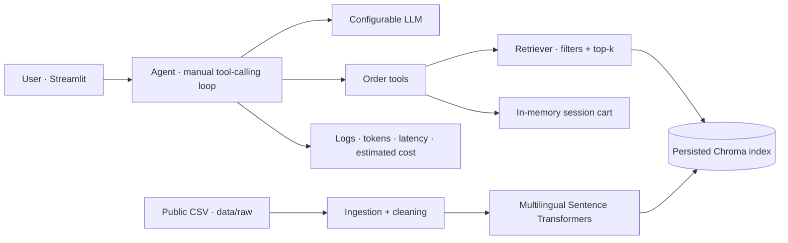

# food-order-agent

[Versão em português](README.md)

A conversational food-ordering assistant in Portuguese that searches restaurant menus, recommends retrieved items, and manages a session-based cart. The project demonstrates real-world data ingestion, multilingual semantic search, manual tool calling, and basic ordering guardrails.

> **Demo, not a delivery service.** The dataset contains menus from restaurants in the United States and prices in US dollars. The project does not place orders with restaurants or process payments.

## Architecture



## Dataset and ingestion

The file at `data/raw/menu_items.csv` comes from the public page [Every item on the menu at 50 new restaurants](https://www.248.ai/blog/every-item-on-the-menu-at-50-new-restaurants). The inspected CSV has 5,213 rows and these columns: `restaurant`, `type`, `city`, `state`, `opened`, `section`, `item`, `description`, `price`, and `source_url`.

In the CSV, `type` identifies the cuisine category, and `price` is stored as text. During ingestion, the system preserves the original price and extracts numeric values for filtering. For price ranges, the filter uses the lowest listed amount. Items without a numeric price are excluded from searches with a price cap. Each item is converted into a document with a stable ID and metadata, then stored in Chroma.
```powershell
python -m src.ingest
```

On the first run, Sentence Transformers downloads `paraphrase-multilingual-MiniLM-L12-v2`. Embeddings are computed locally and persisted in `data/processed/chroma/`. The retriever can match Portuguese queries against English menu text.

## Run locally

Requires Python 3.11 or later.

Run the commands below from the project root: the directory containing `app.py`. In VS Code, open the terminal with that folder open.

Create the virtual environment:

```powershell
py -3.12 -m venv .venv
```

```powershell
.\.venv\Scripts\python.exe -m pip install --upgrade pip
```

```powershell
.\.venv\Scripts\python.exe -m pip install -r requirements.txt
```

```powershell
Copy-Item .env.example .env
```

The default provider is the Gemini API with `gemini-3.1-flash-lite`. Create a key in [Google AI Studio](https://aistudio.google.com/app/apikey) and set `LLM_API_KEY` in `.env`. Free-tier availability, limits, and terms can change; check the [current Gemini API terms](https://ai.google.dev/gemini-api/docs/pricing). Gemini uses the official `google-genai` SDK; the other providers use the OpenAI-compatible client from `openai`.

`LLM_PROVIDER` also supports `groq`, `openai`, and `openrouter`; set the matching key in `LLM_API_KEY`. `LLM_BASE_URL` can point to another OpenAI-compatible endpoint.

```powershell
.\.venv\Scripts\python.exe -m src.ingest
```

```powershell
.\.venv\Scripts\streamlit.exe run app.py
```

Streamlit displays the chat and cart in the sidebar. Tool-call logs are available in an expander. If the index does not exist, the page offers a button to create it. The cart lives in the Streamlit session and is cleared when the session is lost or the app restarts.

## Evaluation and tests

There are 30 cases in `eval/cases.jsonl`, covering dietary restrictions, price limits, ambiguous queries, and requests with no matching results. Run the offline evaluation:

```powershell
.\.venv\Scripts\python.exe eval/run_eval.py
```

Offline mode uses a deterministic fixture model. It measures hit@5, tool execution, local latency, and zero inference cost. Its tool-call rate validates the execution path; it **does not** measure whether an LLM chooses the right tool. To make live provider calls and measure their latency and estimated cost:

```powershell
.\.venv\Scripts\python.exe eval/run_eval.py --live
```

Estimated cost uses `LLM_INPUT_COST_PER_1M` and `LLM_OUTPUT_COST_PER_1M` in `.env`. Both default to zero and must be set for the provider and model in use. The latest recorded results are in [eval/results.md](eval/results.md).

```powershell
.\.venv\Scripts\python.exe -m pytest -q --basetemp=.pytest-tmp
```

The `--basetemp` option is useful on restricted Windows environments where the global temporary directory is not writable.

## Design decisions

- The tool-calling loop is implemented manually in `src/agent.py`, with a configurable step limit and API/tool error handling.
- `src/llm.py` provides one interface: the official SDK for Gemini and an OpenAI-compatible client for Groq, OpenAI, and OpenRouter. API keys are read from the environment.
- The index stores normalized embeddings and uses cosine distance. The retriever maps Portuguese cuisine filters to dataset labels and applies price limits using metadata.
- Order confirmation is enabled only after the agent asks for confirmation and the user explicitly agrees. `confirmar_pedido` does not integrate with an external service.
- Menu descriptions are not treated as proof of allergen or cross-contamination safety.
- Turn logs store tool names, arguments, results, provider-reported tokens, latency, and configured estimated cost.

## Limitations

- Menu data is in English, prices are in US dollars, and availability and data quality depend on the original source. It does not represent any specific delivery platform's current catalog.
- Vector similarity alone cannot verify dietary restrictions. The interface advises users to confirm allergens directly with the restaurant.
- Some descriptions and prices are missing. Price ranges use the lowest listed amount, which may not match the desired serving option.
- The cart is temporary and has no checkout, payment, delivery, inventory, persistence, or authentication.
- Provider compatibility depends on support for the relevant API and tool calling.
- The similarity threshold (`RAG_MIN_SCORE`) is a configurable heuristic, not a guarantee against false positives.

## Next steps

1. Create a human-judged evaluation set and calibrate retrieval thresholds with precision and coverage metrics.
2. Add hybrid lexical retrieval and explicit allergen filters only when the data supports them.
3. Persist carts and orders with authentication; implement checkout only through an authorized API.
4. Separate catalogs by region, currency, and availability, and add incremental index updates.
5. Add CI with tests, linting, and regression evaluation.
