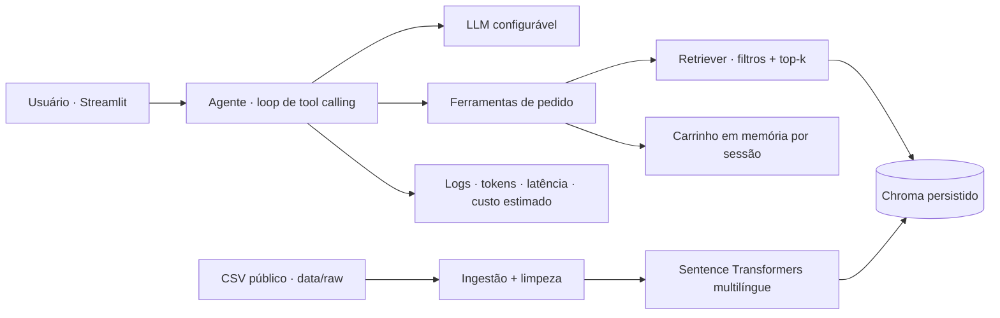

# food-order-agent

[English version](README.en.md)

Agente conversacional em português para explorar cardápios, recomendar itens encontrados via RAG e montar um carrinho por sessão. O projeto demonstra ingestão de dados reais, busca semântica multilíngue, chamada manual de ferramentas e guardrails simples para pedidos.

> **Demonstração, não serviço de entrega.** O dataset contém cardápios de restaurantes dos Estados Unidos e preços em dólares. O projeto não envia pedidos a restaurantes nem processa pagamentos.

## Arquitetura



## Dataset e ingestão

O arquivo em `data/raw/menu_items.csv` vem da página pública [Every item on the menu at 50 new restaurants](https://www.248.ai/blog/every-item-on-the-menu-at-50-new-restaurants). A inspeção do CSV encontrou 5.213 linhas e as colunas `restaurant`, `type`, `city`, `state`, `opened`, `section`, `item`, `description`, `price` e `source_url`.

No CSV, a coluna `type` informa a categoria culinária, e a coluna `price` contém os preços em texto. Durante a ingestão, o sistema preserva o preço original e extrai valores numéricos para permitir filtros. Quando há uma faixa de preços, o filtro considera o menor valor. Itens sem preço numérico não aparecem em buscas com limite de preço. Cada item é convertido em um documento com identificador estável e metadados, armazenado no Chroma.

```powershell
python -m src.ingest
```

Na primeira execução, o Sentence Transformers baixa o modelo `paraphrase-multilingual-MiniLM-L12-v2`. Os vetores são calculados localmente e persistidos em `data/processed/chroma/`. A busca recebe consultas em português e texto de menu em inglês.

## Rodar localmente

Requer Python 3.11 ou superior.

Execute os comandos abaixo na raiz do projeto, isto é, na pasta que contém `app.py`. No VS Code, abra o terminal com essa pasta aberta.

Crie o ambiente virtual:

```powershell
py -3.12 -m venv .venv
```

```powershell
.\.venv\Scripts\python.exe -m pip install --upgrade pip
```

```powershell
.\.venv\Scripts\python.exe -m pip install -r requirements.txt
```

```powershell
Copy-Item .env.example .env
```

O padrão usa a Gemini API com `gemini-3.1-flash-lite`. Crie uma chave no [Google AI Studio](https://aistudio.google.com/app/apikey) e preencha `LLM_API_KEY` no `.env`. Disponibilidade, limites e condições da faixa gratuita podem mudar; confira as [condições atuais](https://ai.google.dev/gemini-api/docs/pricing) antes de usar. O Gemini usa o SDK oficial `google-genai`; os outros provedores usam a API OpenAI-compatible via `openai`.

`LLM_PROVIDER` também aceita `groq`, `openai` e `openrouter`; configure a chave correspondente em `LLM_API_KEY`. `LLM_BASE_URL` permite apontar para outro endpoint OpenAI-compatible.

```powershell
.\.venv\Scripts\python.exe -m src.ingest
```

```powershell
.\.venv\Scripts\streamlit.exe run app.py
```

O Streamlit mostra a conversa e o carrinho na lateral. Os logs de ferramentas ficam no expander. Sem índice, a página apresenta o botão para criá-lo. O carrinho é mantido em memória na sessão do Streamlit e some ao reiniciar ou perder a sessão.

## Avaliação e testes

Há 30 casos em `eval/cases.jsonl`, cobrindo restrições alimentares, preço, consultas ambíguas e pedidos sem correspondência. Rode a avaliação offline:

```powershell
.\.venv\Scripts\python.exe eval/run_eval.py
```

O modo offline usa um modelo fixture determinístico: mede hit@5, execução das ferramentas, latência local e custo zero de inferência. A taxa de ferramenta nesse modo valida o caminho de execução e **não** mede a escolha de ferramenta pelo LLM. Para fazer chamadas reais, com custo e latência do provedor:

```powershell
.\.venv\Scripts\python.exe eval/run_eval.py --live
```

O custo estimado usa `LLM_INPUT_COST_PER_1M` e `LLM_OUTPUT_COST_PER_1M` em `.env`; valores padrão são zero e precisam ser ajustados para o modelo/provedor em uso. Resultados da execução atual estão em [eval/results.md](eval/results.md).

```powershell
.\.venv\Scripts\python.exe -m pytest -q --basetemp=.pytest-tmp
```

O caminho `--basetemp` é útil em ambientes Windows restritos em que o diretório temporário global não permite escrita.

## Decisões de design

- O loop de chamadas de ferramenta é manual em `src/agent.py`, com número máximo de passos e tratamento de falhas de API/ferramenta.
- `src/llm.py` concentra a interface única: SDK oficial para Gemini e cliente OpenAI-compatible para Groq, OpenAI e OpenRouter. Chaves ficam apenas no ambiente.
- O índice armazena embeddings normalizados e usa distância cosseno. O retriever traduz filtros de culinária em português para rótulos do dataset e aplica teto de preço via metadados.
- A confirmação só fica autorizada depois de o agente pedir confirmação e o usuário responder afirmativamente. `confirmar_pedido` não faz integração externa.
- O agente não trata descrições do menu como comprovação de segurança para alergias ou contaminação cruzada.
- Logs de turno guardam ferramenta, argumentos, resultado, tokens informados pelo provedor, latência e custo configurado.

## Limitações

- Dados em inglês, preços em dólares e disponibilidade/qualidade dependentes da fonte original; não representam o catálogo atual de uma plataforma específica.
- Similaridade vetorial isolada não garante que uma restrição alimentar seja atendida. A interface orienta o usuário a confirmar alergênicos diretamente com o restaurante.
- O dataset tem descrições e preços ausentes; faixa de preço usa o menor valor anunciado e pode não refletir a opção desejada.
- O carrinho é efêmero, sem checkout, pagamento, entrega, estoque, persistência ou autenticação.
- Compatibilidade depende de o provedor expor API OpenAI-compatible e tool calling.
- O limiar de similaridade é uma heurística configurável (`RAG_MIN_SCORE`), não uma garantia de ausência de falsos positivos.

## Próximos passos

1. Criar uma avaliação julgada por pessoas e calibrar limiar/consultas com métricas de precisão e cobertura.
2. Adicionar recuperação lexical híbrida e filtros explícitos para alergênicos somente quando os dados sustentarem a afirmação.
3. Persistir carrinho e pedidos com autenticação e implementar checkout apenas contra uma API autorizada.
4. Separar catálogo por região, moeda e disponibilidade e adicionar atualização incremental do índice.
5. Integrar CI com testes, lint e avaliação de regressão.
